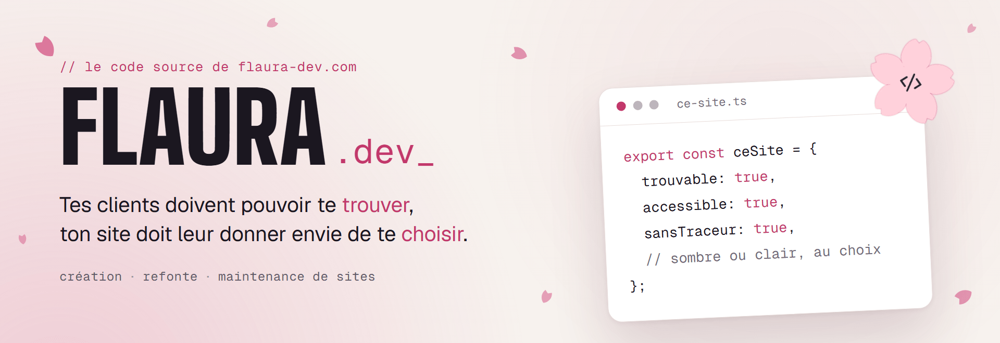

<a href="https://flaura-dev.com">
  <picture>
    <source media="(prefers-color-scheme: dark)" srcset=".github/readme/banniere-sombre.png" />
    
  </picture>
</a>

<p align="center">
  <a href="https://flaura-dev.com"><b>flaura-dev.com</b></a>
  &nbsp;·&nbsp;
  <a href="https://calendly.com/flaura-devweb/cafe">Réserver un café virtuel</a>
  &nbsp;·&nbsp;
  <a href="https://www.linkedin.com/in/laura-fontaine-devweb83">LinkedIn</a>
</p>

<p align="center">
  
  
  
  
</p>

Le site vitrine de **Flaura.dev** : création et refonte de sites internet pour les TPE et les indépendants, dans le Var et à distance.

Je suis Laura Fontaine, développeuse web freelance. Ce dépôt est public parce qu’un site se juge aussi à ce qu’il y a sous le capot : voici le mien.

## `01` Sous le capot

| Ce que voit le visiteur                        | Ce que fait le code                                                                                                                                                       |
| ---------------------------------------------- | ------------------------------------------------------------------------------------------------------------------------------------------------------------------------- |
| **Le site s’affiche vite**                     | Pages statiques, polices hébergées avec le site (`next/font`), images optimisées par `next/image`                                                                         |
| **Clair ou sombre, comme son téléphone**       | Thème appliqué avant le premier affichage, donc sans flash ; un bouton pour changer, et le choix est retenu                                                               |
| **Aucun bandeau cookies à fermer**             | Ni cookie ni traceur sur le site : l’agenda Calendly ne se charge qu’au clic                                                                                              |
| **Le formulaire marche, même sans JavaScript** | Server Action validée côté serveur avec `zod`, anti-spam sans captcha ni service tiers, envoi par un relais SMTP européen                                                 |
| **Tout le monde peut le parcourir**            | Contrastes AA, navigation au clavier, cibles tactiles de 44 px, textes en `rem`, `prefers-reduced-motion`, `prefers-contrast` et `prefers-reduced-transparency` respectés |
| **Google comprend de quoi il parle**           | Métadonnées, Open Graph, sitemap et données structurées JSON-LD générées à partir du contenu                                                                              |
| **Il est protégé**                             | En-têtes de sécurité stricts : CSP, HSTS, `Permissions-Policy`, `X-Frame-Options`…                                                                                        |

## `02` Les détails

- Une frise « Comment on travaille ensemble » qui avance seule et s’arrête dès qu’on choisit une étape.
- Un fil conducteur à droite de l’écran à la place de la barre de défilement : il suit la lecture, se glisse, et chaque section y a son repère.
- Un comparateur avant/après glissable pour les refontes, et des captures pleine page qui défilent au survol.
- Un menu en pilule dont la bulle rose suit la section en cours.
- Une chute discrète de pétales, que chacun peut couper, et qui s’arrête d’elle-même si le système demande moins d’animations.

## `03` Organisation du code

```
app/          pages, métadonnées, sitemap, robots et envoi du formulaire
components/   sections de l’accueil, mise en page, projets, briques d’interface
content/      textes, prix, FAQ et projets, séparés du code
lib/          thème, e-mail, limite d’envoi, données structurées
assets/       logos, photos et captures des projets
```

Les textes et les prix vivent dans `content/`, jamais dans les composants : changer un tarif met à jour d’un coup la carte de l’offre, la FAQ et les données structurées.

## `04` Lancer le projet

Il faut Node.js 20.9 ou plus récent.

```bash
npm install
npm run dev
```

| Commande            | Rôle                                        |
| ------------------- | ------------------------------------------- |
| `npm run dev`       | serveur de développement sur localhost:3000 |
| `npm run build`     | build de production                         |
| `npm run lint`      | ESLint                                      |
| `npm run typecheck` | vérification TypeScript                     |
| `npm run format`    | mise en forme avec Prettier                 |

Le formulaire de contact a besoin d’identifiants SMTP : copie `.env.example` en `.env.local` et remplis-le. Sans eux, le reste du site fonctionne normalement.

## `05` Droits

© 2026 Laura Fontaine — Flaura.dev. Tous droits réservés.

Le code est visible publiquement à titre de démonstration. Aucune licence n’est accordée : textes, photos, logos, design et code ne peuvent pas être réutilisés sans autorisation écrite.

---

<p align="center">
  Un projet de site ? On en parle autour d’un <a href="https://calendly.com/flaura-devweb/cafe">café virtuel</a> de 30 minutes, sans engagement.
</p>
